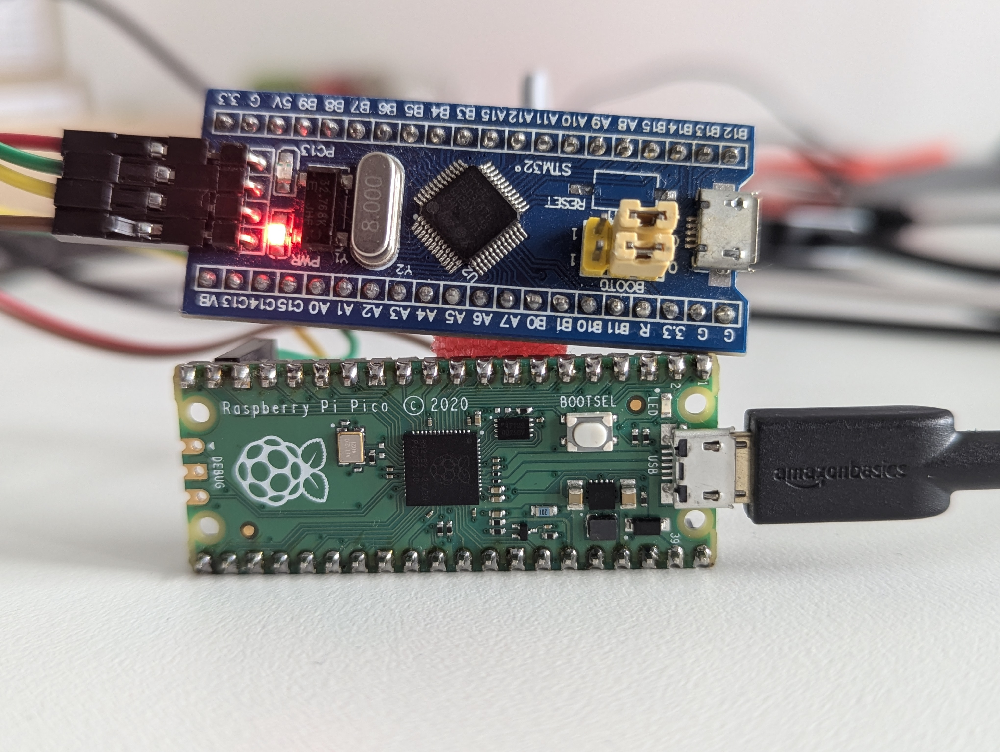
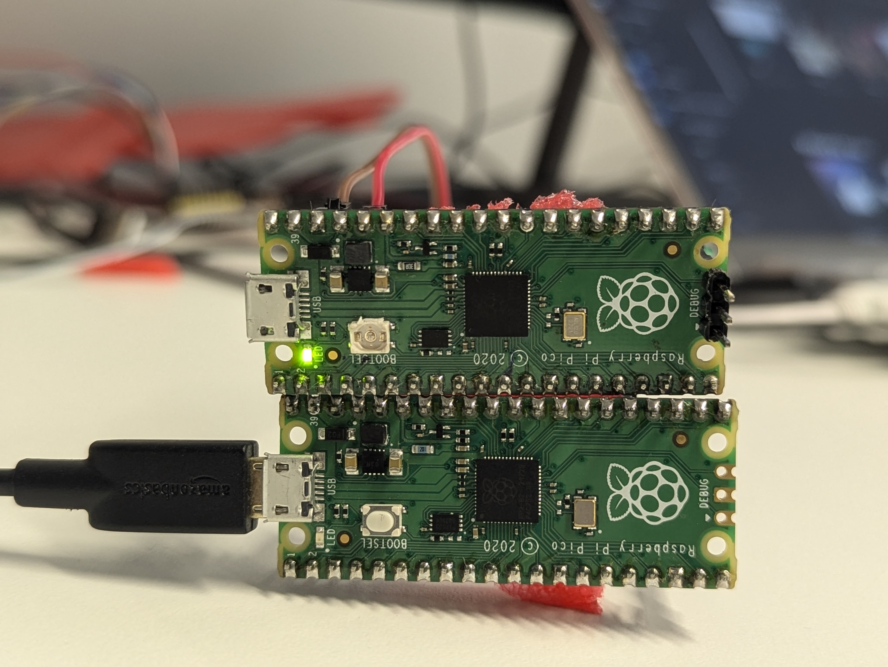

# JTAGprobe_smp
A CMSIS-DAP v2 JTAG and SWD debug probe firmware with an integrated USB CDC-ACM UART serial bridge for the **Raspberry Pi Pico (RP2040)**, running on the **µOS++ III SMP** kernel across both Cortex-M0+ cores.

It is JTAGprobe (branch `jtagprobe-new`, with all of its speed optimizations) with FreeRTOS replaced by µOS++ III SMP (`micro-os-plus-iii-smp`). The Pico SDK still boots the board; the kernel then schedules the probe's threads on both cores: **core 0** serves the USB host (tinyusb) and the UART bridge, **core 1** runs nothing but the CMSIS-DAP commands (the JTAG/SWD bit-banging).

---

## Features

- **JTAG & SWD Debugging:** Full CMSIS-DAP v2 bulk transport support for OpenOCD, pyOCD, probe-rs, and Keil MDK.
- **Hardware USB CDC-ACM UART Bridge:** Virtual COM port (`/dev/ttyACMx` on Linux, `COMx` on Windows) bridged directly to target UART on GPIO 12/13.
- **High Performance:**
  - Zero blocking debug logging overhead on DAP transfers.
  - Single-cycle RP2040 SIO atomic register operations for high-speed bit-banging.
  - Multi-packet ring buffer (4 slots) preventing USB NAK back-offs.
- **Dual-core (SMP):** the DAP thread has core 1 to itself, so JTAG/SWD bit-banging overlaps the USB transfers and the UART bridge on core 0.
- **Dynamic Baud Rate:** Automatically adjusts hardware UART baud rate, parity, stop bits, and data bits when changed by the host terminal software.
- **Supported Hardware:**
  - Raspberry Pi Pico (RP2040). The µOS++ port in this tree (`micro-os-plus-iii-rp2040`) is RP2040-only; there is no Pico 2 (RP2350) build of JTAGprobe_smp.

---

## µOS++ III SMP Integration

### Source layout

| Path | What it is |
| :--- | :--- |
| `micro-os-plus/micro-os-plus-iii/` | The µOS++ III SMP kernel, unmodified (a `git archive` of `micro-os-plus-iii`, branch `smp`, commit `931f1380`). CMake INTERFACE library `micro-os-plus::iii`. |
| `micro-os-plus/micro-os-plus-iii-rp2040/` | The RP2040 port, an INTERFACE library `micro-os-plus::rp2040` on top of the kernel, built the way the `micro-os-plus-iii-smp` tests link `micro-os-plus::cortexm`. |
| `src/cmsis-plus/os-app-config.h` | The kernel configuration: 1000 Hz tick, stack sizes. |
| `src/probe_os.h` | The objects the threads share: `usb_mutex`, `usb_sem`, `dap_sem`, `uart_sem`. |
| `CMakeLists.txt` | Pico SDK project; `add_subdirectory(micro-os-plus/micro-os-plus-iii-rp2040)` and links `micro-os-plus::rp2040`. |

### The RP2040 port

| Item | Implementation |
| :--- | :--- |
| CPUs | `OS_NCPU=2`, `OS_USE_SMP_SCHEDULER=1` |
| Context switch | ARMv6-M PendSV, lowest priority, one per core |
| Tick | SysTick on both cores, 1 kHz; only core 0 advances the system clock |
| Kernel lock | SIO hardware spinlock `PICO_SPINLOCK_ID_OS1` (14), the one the Pico SDK reserves for an RTOS |
| Critical sections | PRIMASK |
| Cross-core IPI | SIO inter-core FIFO, `SIO_IRQ_PROC0` / `SIO_IRQ_PROC1` |
| High-resolution clock | `time_us_64()` (1 MHz timer) |
| Core 1 start | `os_rp2040_start_core1()` → `multicore_launch_core1_raw()` on the SDK's core-1 stack, then an `idle1` thread |
| Free store | `__end__` … `__HeapLimit` (the SDK linker script's heap) |
| Process exit | The Pico SDK's `exit()`; the port removes the kernel's `src/libc/stdlib/exit.c` from the build |

### Threads

| Thread | Priority | Core | Job |
| :--- | :--- | :---: | :--- |
| `UART` | high | 0 | CDC ↔ `uart0` bridge (must preempt USB, or characters are lost) |
| `TUD` | above normal | 0 | `tud_task()`, then services the DAP endpoints |
| `DAP` | normal | 1 | `DAP_ExecuteCommand()`: the JTAG/SWD bit-banging |
| `main` | — | 0 | `os_main()`: probe init, creates the threads, starts core 1 |

tinyusb is built with `OPT_OS_NONE`; every tinyusb call is made with `usb_mutex` held. The DAP requests and responses cross between the cores in two lock-free single-producer/single-consumer rings (`src/tusb_edpt_handler.c`). The DAP thread busy-waits up to 2 ms for the next packet before it sleeps, and starts the IN transfer of each response itself when it gets `usb_mutex` (otherwise the `TUD` thread does it right after `tud_task()`). The `TUD` thread likewise keeps polling `tud_task()` for 2 ms after the last DAP packet instead of sleeping.

### Packet timing

The firmware keeps per-stage packet timing (OUT → DAP start, DAP execution, response → IN, IN transfer, OUT → OUT, OUT stalls), read from OpenOCD with the DAP vendor command `0x80`:

```tcl
cmsis-dap cmd 0x80 0xff     ;# reset the counters
cmsis-dap cmd 0x80 <i>      ;# read counter i (0..11), printed as "Returned data b0 b1 b2 b3"
```

The counters and a measured breakdown are in `PERFORMANCE_ANALYSIS_AND_OPTIMIZATION.md` § 8.5 and § 9.4.

---

## OpenOCD Load Times (Raspberry Pi 4 B over JTAG)

`load_image` of µOS++ test ELFs into a Raspberry Pi 4 B (BCM2711) over JTAG, OpenOCD `adapter speed 4000`, CMSIS-DAP v2 bulk, timed around `load_image` alone. See `PERFORMANCE_ANALYSIS_AND_OPTIMIZATION.md` § 9 for every measurement and the per-test table.

| Probe firmware | Measured rate | ~80 KB image |
| :--- | :---: | :---: |
| Stock debugprobe 2.0.0 | ~1.05 KB/s | ~77 s |
| JTAGprobe `jtagprobe-new` (FreeRTOS, single core) | 34.0–39.5 KB/s | 2.0–2.4 s |
| JTAGprobe_smp, first build (DAP thread sleeps per packet) | 9.95 KB/s | 8.1 s |
| JTAGprobe_smp, second build (DAP thread spins, sends its own responses) | **37.8–38.1 KB/s** | **2.1 s** |
| JTAGprobe_smp, current build (+ `TUD` spin, packet timing) | **37.6–37.8 KB/s** | **2.1 s** |

The SMP build loads at the speed of the optimized single-core firmware (about 3.8× faster than the first SMP build, about 36× the stock firmware), and the whole `smp_mem_test` ran in 54.2 s, against 140 s with the single-core firmware. Its packet counters show the core-to-core hand-off costs ~7 µs of a ~263 µs cycle; the rest is the JTAG bit-banging (~68 µs) and the USB round trip with the PC (~188 µs). With the target's semihosting prints on (`SEMI_PRINTS=1`), smp_mem_test passes in 337 s (~0.9 s per semihosted line, OpenOCD reading each string byte by byte).

---

## Pinout Mapping

Connect the probe to your target board as follows:

| Signal | RP2040 GPIO | Pico Header Pin | Direction / Role | Description |
| :--- | :---: | :---: | :--- | :--- |
| **SWCLK / TCK** | **GPIO 19** | **Pin 25** | Output (Probe $\rightarrow$ Target) | SWD Clock / JTAG Test Clock |
| **SWDIO / TMS** | **GPIO 14** | **Pin 19** | Bi-directional | SWD Data I/O / JTAG Test Mode Select |
| **TDI** | **GPIO 18** | **Pin 24** | Output (Probe $\rightarrow$ Target) | JTAG Test Data In |
| **TDO** | **GPIO 21** | **Pin 27** | Input (Probe $\leftarrow$ Target) | JTAG Test Data Out |
| **nTRST** | **GPIO 15** | **Pin 20** | Output (Probe $\rightarrow$ Target) | JTAG Test Reset (optional) |
| **nRESET** | **GPIO 16** | **Pin 21** | Open-drain (Target Reset) | System Reset |
| **UART_TXD** | **GPIO 12** | **Pin 16** | Output (Probe $\rightarrow$ Target) | Target UART RX (from Pico `uart0`) |
| **UART_RXD** | **GPIO 13** | **Pin 17** | Input (Probe $\leftarrow$ Target) | Target UART TX (to Pico `uart0`) |
| **GND** | **GND** | **Pin 3, 8, 13, 18, 23, 28, 38** | Ground | Common Ground Reference |

---

## USB Interfaces & Serial Port

When plugged into a host PC, JTAGprobe_smp enumerates as a composite USB device:

1. **Interface 0 (Vendor Specific Bulk):**
   - CMSIS-DAP v2 interface used by OpenOCD, pyOCD, and debuggers via `libusb`.
   - *Note:* CMSIS-DAP is **not** a serial/tty device and will not appear under `/dev/tty*`.
2. **Interfaces 1 & 2 (CDC-ACM UART Bridge):**
   - Creates a **`/dev/ttyACMx`** on Linux (`/dev/ttyACM0` if it is the only one; or `COMx` on Windows).
   - In system logs (`dmesg`, `/dev/serial/by-id/`), the port inherits the USB product string `JTAG probe on Pico (CMSIS-DAP)`. **It is the serial console port connected to GPIO 12 & 13.**

### Opening the UART Console

Use any serial terminal application (e.g. `picocom`, `minicom`, `screen`, PuTTY):

```bash
# Using picocom at 115200 baud
picocom -b 115200 /dev/ttyACM0

# Using minicom
minicom -b 115200 -o -D /dev/ttyACM0
```

---

# Images of debugging PICO with another PICO and Bluepill






# Building from Source

### 1. Prerequisites

- **Raspberry Pi Pico SDK** &mdash; Set the `PICO_SDK_PATH` environment variable:
  ```bash
  export PICO_SDK_PATH=/path/to/pico-sdk
  ```
- **CMake** (3.20 or higher; the µOS++ CMake files need it)
- **GCC ARM Embedded Toolchain** (`arm-none-eabi-gcc`)
- **Ninja** (or `make`)
- **picotool** (found by the SDK, e.g. `-Dpicotool_DIR=$HOME/.local/lib/cmake/picotool`)

The µOS++ kernel and its RP2040 port are already in `micro-os-plus/`; nothing else needs fetching.

### 2. Building the Firmware (Raspberry Pi Pico, RP2040)

From the folder that holds `JTAGprobe_smp/`:

```bash
cmake -S JTAGprobe_smp -B JTAGprobe_smp/build/pico -G Ninja -DPICO_BOARD=pico
ninja -C JTAGprobe_smp/build/pico
```
The output binary is: **`build/pico/JTAGprobe_smp.uf2`**

The firmware is linked `copy_to_ram`: it runs from SRAM, not from XIP flash.

---

## Flashing the Firmware

1. **Hold the BOOTSEL button** on your Pico board.
2. **Plug the board into your computer's USB port** while holding BOOTSEL (the device mounts as a mass-storage drive named `RPI-RP2`).
3. **Copy `build/pico/JTAGprobe_smp.uf2`** to the drive.
4. The Pico will automatically reboot and start running JTAGprobe_smp with CMSIS-DAP v2 and USB CDC UART on GPIO 12/13.

---

## Final Reflection: One CPU vs Two CPUs

Measured on a Raspberry Pi 4 B target over JTAG with OpenOCD 0.12 (`adapter speed 4000`), comparing the optimized single-core FreeRTOS JTAGprobe (`jtagprobe-new`) with JTAGprobe_smp (µOS++ III SMP, DAP on core 1, USB and UART on core 0). Details in `PERFORMANCE_ANALYSIS_AND_OPTIMIZATION.md` § 9 and § 11.

| | 1 CPU (FreeRTOS) | 2 CPUs (JTAGprobe_smp) |
| :--- | ---: | ---: |
| `load_image`, smp_mem_inter_test (80,984 B) | 2,380 ms (34.0 KB/s) | **2,106–2,143 ms (37.8–38.5 KB/s)** |
| Whole smp_mem_test (CTest, reset wait included) | 140 s | **50–54 s** |
| Whole smp_mem_inter_test | 190 s | 186–193 s |

**JTAG operations (bulk, e.g. `load_image`).** Two CPUs give about the same speed as one: the load is a strict request/reply exchange (OpenOCD sends one packet, ~9.9 loaded bytes, and waits for its answer). Of a ~263 µs cycle the probe's counters show ~68 µs of bit-banging, ~7 µs of hand-off between the two cores and ~188 µs of USB transfer and PC turnaround. A second core cannot overlap anything in a chain where each step waits for the previous one; it can only cost time if the hand-off sleeps. The first SMP build did exactly that (two cross-core wake-ups per packet, ~1 ms per packet, 4× slower), and keeping the packet path free of sleeps (the DAP thread spins and sends its own reply) brought it back to single-core speed.

**JTAG operations (scattered, e.g. a running test).** Here two CPUs pay off: smp_mem_test, whose run is OpenOCD polling the four Cortex-A72 cores between short exchanges, finished in 50–54 s instead of 140 s. The DAP work on core 1 never waits behind USB event handling or the UART on core 0. (The exact share of each factor was not profiled.) Where the test itself dominates (smp_mem_inter_test, ~170 s of computing on the Pi), one or two probe CPUs make no measurable difference: 186–193 s against 190 s, within its run-to-run spread.

**UART.** On one CPU the UART bridge task and the DAP task share a core, so the bridge has to preempt the bit-banging to avoid losing characters. On two CPUs the UART thread runs on core 0 next to USB and never delays a DAP command, and no DAP burst can delay the UART. The tests ran with the full console on the UART and passed; the bridge throughput itself was not benchmarked.

**Semihosting.** To the probe a semihosting call is just more JTAG traffic, so it benefits like any scattered JTAG work. But its cost is set by OpenOCD: `SYS_WRITE0` reads the string from the target one byte per JTAG access, about 0.9 s per console line. With every core-0 line sent through semihosting (`SEMI_PRINTS=1`) smp_mem_test takes 337 s and smp_mem_inter_test 621 s, against 50–54 s and 186–193 s without. Neither one nor two probe CPUs change that; reading the string in blocks on the host would. On this board OpenOCD also serves semihosting only from core 0 of the target: a call from cores 1–3 leaves that core halted.

**Where the next gains are.** Not in another split of work between the two Pico cores (the hand-off is already ~7 µs per packet), but in fewer round trips (a larger `DAP_PACKET_SIZE`, so OpenOCD packs more into each command), faster bit-banging (PIO), and on the host side (block reads for semihosting strings).
